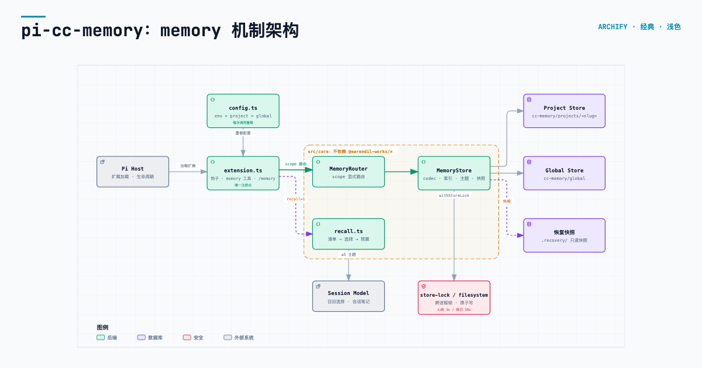
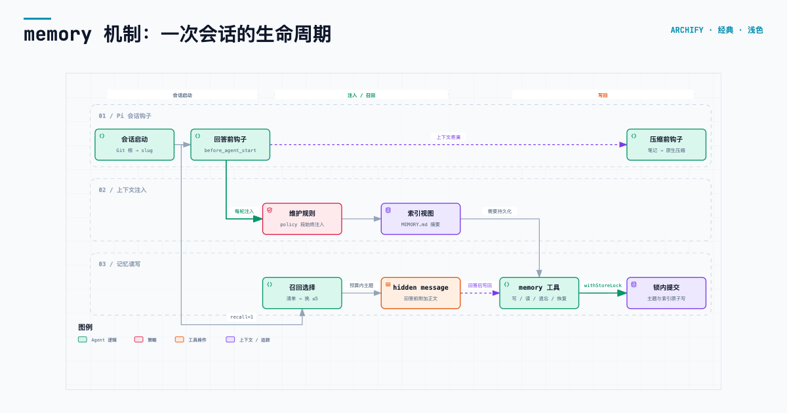

# pi-cc-memory

Project- and user-scoped, file-based memory for the [Pi](https://pi.dev) coding
agent, modeled on Claude Code's auto memory.

Memory is plain Markdown: per-store indexes (`MEMORY.md`) plus one file per topic
with a short frontmatter block. The model reads and writes it through a dedicated
tool, so memory survives sessions, compactions and worktrees without a database.

Two stores:

- **project** — facts about the current repository, keyed by the canonical Git root.
- **global** — stable cross-project facts about the user and how to collaborate.
  Can be disabled entirely. Routing is always an explicit `scope`, never guessed
  from the memory type.

> Status: **M2 verified with process/SDK tests and real-model acceptance**. Session continuity notes, recoverable deletion, cross-process locking
> and Pi settings extend the M1 memory/recall path. Background extraction and
> consolidation remain planned for M3. See [docs/milestones.md](docs/milestones.md).

## Diagrams

Two views of the same mechanism. They are generated from the source
specifications in [`docs/diagrams/`](docs/diagrams).

**Architecture** — Pi host → `extension.ts` wiring → host-neutral core, with the
project and global stores and the lock/recovery path behind every mutation.



**Session lifecycle** — from `session_start` through per-run injection or recall,
a `memory` tool write committed under the store lock, and the pre-compaction note.



The interactive HTML versions (`memory-architecture.html`,
`memory-lifecycle.html`) add pan/zoom, search, focus and theme switching when
opened locally.

## Install

```bash
pi install ./path/to/pi-cc-memory      # local checkout
pi install git:github.com/escapeWu/pi-cc-memory
```

Or try one invocation without installing:

```bash
pi -e ./path/to/pi-cc-memory
```

## What it does

- Injects a memory maintenance policy into the system prompt on every run.
- Injects both `MEMORY.md` indexes as a stable session snapshot by default, so
  the model can navigate topics without loading their bodies or rewriting the
  cached prompt after ordinary memory writes.
- Gives the model a `memory` tool with an explicit `scope`
  (`project | global`): `status | list | read | write | forget | restore | index | search`.
- Warns, but does not block, when a memory type and scope suggest different tiers.
- Optionally recalls relevant topics before the first answer, using the session
  model to select from a scope-tagged frontmatter manifest.
- Adds `/memory` for status, `/memory index` for indexes and `/memory note` for
  the active branch's latest session-note snapshot.
- Keeps a bounded session note for native compaction and returns a recovery id
  when a topic is forgotten.

## Storage

```text
~/.pi/agent/cc-memory/
├── global/                      # cross-project: user identity, feedback
│   ├── MEMORY.md
│   └── user_language.md
└── projects/<project>-<hash8>/  # repository facts
    ├── MEMORY.md
    └── infra_deploy.md
```

The project store is keyed by the canonical Git root, so linked worktrees share
memory. The plugin writes under its own `cc-memory/` subtree: it never adopts or
overwrites an existing `~/.pi/agent/memory` installation.

## Configuration

| Variable | Default | Meaning |
| --- | --- | --- |
| `PI_CC_MEMORY_DIR` | — | Exact project store root (absolute or `~/...`) |
| `PI_CC_MEMORY_GLOBAL` | `1` | `0` disables the global store entirely |
| `PI_CC_MEMORY_GLOBAL_DIR` | `<agentDir>/cc-memory/global` | Exact global store root |
| `PI_CC_MEMORY_DEFAULT_SCOPE` | `project` | Scope used when a tool call omits `scope` |
| `PI_CC_MEMORY_RECALL` | `0` | `1` enables recall and stops injecting the index |
| `PI_CC_MEMORY_RECALL_MODEL` | session model | `provider/model` used for selection |
| `PI_CC_MEMORY_RECALL_FILES` | `5` | Max topics surfaced per request |
| `PI_CC_MEMORY_RECALL_FILE_BYTES` | `4096` | Per-file surfacing cap |
| `PI_CC_MEMORY_RECALL_SESSION_BYTES` | `61440` | Recall bytes in effective context; compaction releases discarded messages |
| `PI_CC_MEMORY_RECALL_TIMEOUT_MS` | `8000` | Selection timeout; failure means no recall |
| `PI_CC_MEMORY_INDEX_LINES` | `200` | Index line budget |
| `PI_CC_MEMORY_INDEX_BYTES` | `24000` | Index UTF-8 byte budget |
| `PI_CC_MEMORY_TOPIC_BYTES` | `32768` | Per-topic UTF-8 byte budget |
| `PI_CC_MEMORY_SESSION_NOTE` | `1` | Generate a continuity note before native compaction |
| `PI_CC_MEMORY_SESSION_NOTE_BYTES` | `4096` | Session-note content budget |
| `PI_CC_MEMORY_SESSION_NOTE_TIMEOUT_MS` | `8000` | Note-generation deadline; failure uses native compaction |

Add a `ccMemory` object to Pi's `<agentDir>/settings.json` and/or
`<cwd>/.pi/settings.json`:

```json
{
  "ccMemory": {
    "recall": { "enabled": true, "maxFiles": 3, "modelRef": "provider/model" },
    "global": { "enabled": true, "defaultScope": "project" },
    "indexLimits": { "maxLines": 200, "maxBytes": 24000 },
    "topicMaxBytes": 32768,
    "sessionNote": { "enabled": true, "maxBytes": 4096, "timeoutMs": 8000 }
  }
}
```

Each field resolves as **env > project settings > global settings > default**.
Recall also accepts `maxCandidates`, `maxFileBytes`, `maxSessionBytes` and
`timeoutMs`. Settings reload on the next tool call or agent start; no restart is
required. Invalid values and unknown fields produce errors naming the file and
field. Store paths are accepted only through the explicit path environment
variables above; project settings cannot redirect a store
([Issue #9](https://github.com/escapeWu/pi-cc-memory/issues/9)).

## Forget and restore

`memory` action `forget` returns `recoveryId` and `scope`. A later session can
recover the exact saved bytes with:

```json
{"action":"restore","scope":"project","recoveryId":"<id returned by forget>"}
```

Restoring refuses to overwrite a newer, different topic. Repeating a successful
restore keeps one index pointer. Recovery snapshots remain in the store's private
`.recovery/` directory, excluded from list/search/recall and index rebuilding
([Issue #7](https://github.com/escapeWu/pi-cc-memory/issues/7)).

## Stable prompt snapshots

The injected policy and indexes stay byte-identical across ordinary turns,
including after writes from this session or another session. Fresh disk contents
remain available through `memory` actions `read`, `search` and `index`, and through
`/memory index`. A new session captures the latest indexes.

Snapshots are persisted as non-context session metadata on the active branch.
Resume, fork, runtime recreation and tree navigation reuse that branch's snapshot;
the metadata is not sent to the model as another message. Existing conversations
without snapshot metadata can reuse their recorded `pi_memory` section when the
policy, store paths, mode and default index-budget contract are compatible.

A successful compaction starts a new snapshot on the next run. Cancelled or failed
compaction leaves the old snapshot intact. Successful `forget` / `restore` actions
refresh the snapshot for the next run, as do changes to store paths, global-store
availability, recall mode or index budgets. Other settings still reload per call
without resampling the indexes. These explicit changes can invalidate a provider's
prefix cache; unrelated tool, prompt, model or upstream cache changes are outside
the snapshot guarantee. Recall mode continues to append selected topics as
persisted custom messages.

## Session continuity

Before compaction, one bounded model call produces a `Current state / Open
threads / Decisions` note from the active branch. Pi keeps it in session metadata;
`/memory note` shows the last snapshot. The native compactor receives the note
without changing its cut point or file tracking. Note-generation failure or
cancellation leaves native behavior in control
([Issue #6](https://github.com/escapeWu/pi-cc-memory/issues/6)).

## Memory format

```markdown
---
name: 集成测试约定
description: 数据库行为及迁移验证的适用条件
type: feedback
---

集成测试需要真实数据库。

**Why:** 用户曾遇到 mock 测试通过、生产迁移失败。
**How to apply:** 修改数据库行为及迁移时采用。
```

Types: `user`, `feedback`, `project`, `reference`. These are content
categories, **not** storage scopes. The intended split is `user`/`feedback` in
`global` and `project`/`reference` in the project store, but only the explicit
`scope` decides where a write lands.

With `PI_CC_MEMORY_GLOBAL=0`, `scope=global` reads and writes fail with an
explicit error. They never fall back to the project store.

## Development

```bash
npm install --include=dev
npm run check     # tsc --noEmit
npm test          # node --test
npm run lint      # biome
npm run test:integration  # actual Pi SDK sessions, deterministic provider, no network

# Explicit live check: uses configured Pi credentials; sends synthetic data only.
PI_CC_MEMORY_LIVE_MODEL=provider/model npm run verify:live
PI_CC_MEMORY_LIVE_MODEL=provider/model npm run verify:m2
```

`npm test` includes the SDK integration suite. It loads the extension through
Pi's resource loader and tests tools, policy/index injection, native compaction,
tree navigation, persistence, resume/fork, project isolation and recall failures.
The live command saves synthetic transcripts and a report under a temporary
directory; it does not install the plugin or change your existing memory.

Core logic (`src/core/`) has no Pi imports and is tested without a runtime.

## Benchmark

The test suite checks correctness; `bench/` measures quality and cost. It uses
synthetic data in temp directories and never touches your real memory.

```bash
npm run bench:l1     # store cost, prompt size and reach vs. topic count (no model)
npm run bench:l2     # recall quality, offline baselines (no model)
PI_CC_MEMORY_LIVE_MODEL=provider/model npm run bench:live   # L2 with the real selector (network)
```

- **L1** times `listHeaders`, `recall()`, `search` and locked `upsert` at 50–5000
  topics, reports what the selector and the system prompt receive per turn, how
  much of the store recall/search/index injection can reach, and cross-process
  write contention.
- **L2** runs the production `recall()` over a labelled bilingual corpus (single,
  multi-topic, near-miss and off-topic queries) and scores selectors against
  `oracle` (ceiling), `lexical` and `substring` baselines. It separates misses
  caused by the candidate window from misses caused by the selector.

First findings (one run, seed 1, 2026-10-27; indicative, not a guarantee):

| Topics | Finding |
| --- | --- |
| 1000 | recall/search reach only the newest 200 topics (20%); 19% of index lines fit the injection budget |
| 5000 | `listHeaders` costs ~430 ms per turn because it reads every topic head before sorting |
| 100 | real selector (`sub2api/deepseek-flash`): recall 98%, precision 97%, 0% false recall on off-topic prompts, 38% on 8 near-miss prompts; the substring `search` baseline finds 0% of natural-language prompts |

The first run also exposed a selector bug that benchmarking fixed: with reasoning
models a 512-token output limit was consumed by thinking, so about 14% of calls
returned nothing silently. The default is now 2048 tokens at minimal reasoning effort,
and truncation or provider errors raise a warning (degraded calls 14% → 2%).

Metric definitions are in [bench/README.md](bench/README.md). The step-by-step
procedure for running, comparing and debugging benchmarks is packaged as a project
skill, [`.agents/skills/memory-benchmark/`](.agents/skills/memory-benchmark/SKILL.md),
for coding agents working in this repository.

## Safety

- Topic paths are validated; absolute paths, traversal, hidden paths, non-Markdown
  targets and `MEMORY.md` itself are rejected.
- Symlinked topics, parent directories and indexes are refused, including new
  topics underneath an existing symlink.
- Writes are atomic (temp file + rename) and mutations are serialized by a
  shared cross-process store lock. Lock waiting is bounded; crashed locks expire.
  This protocol targets local filesystems ([Issue #8](https://github.com/escapeWu/pi-cc-memory/issues/8)).
- Index views are capped by line and UTF-8 byte budgets, including the warning;
  the complete index stays on disk so later writes preserve every pointer.
- A failed index update is reported, never silently treated as success.
- Disabling global memory removes it from injection and recall; targeting it
  returns an error rather than a silent project write.
- `forget` reports when the same relative path still exists in the other store.
- Recall is best-effort and bounded; a slow or failing selector cannot fail a turn.

## Documents

- [docs/claude-code-memory-pipeline.md](docs/claude-code-memory-pipeline.md) —
  analysis of the reference implementation this design is derived from.
- [docs/architecture.md](docs/architecture.md) — layers, storage, gaps.
- [docs/milestones.md](docs/milestones.md) — M1, M2, M3 and exit criteria.
- [bench/README.md](bench/README.md) — benchmark layers, corpus and metric definitions.
- [docs/diagrams/](docs/diagrams/) — architecture and session-lifecycle diagrams:
  PNG previews, interactive HTML, and their JSON specifications.

## Disclaimer

This is an independent implementation, not affiliated with Anthropic or the Pi
maintainers. M1/M2 are verified in isolated Pi SDK sessions, with real model
writes/recall, recoverable deletion and native compaction continuity. Interactive terminal rendering and coexistence with other
memory extensions have not been validated. See [NOTICE](NOTICE),
[SECURITY.md](SECURITY.md) and [PR #14](https://github.com/escapeWu/pi-cc-memory/pull/14).

## License

MIT
