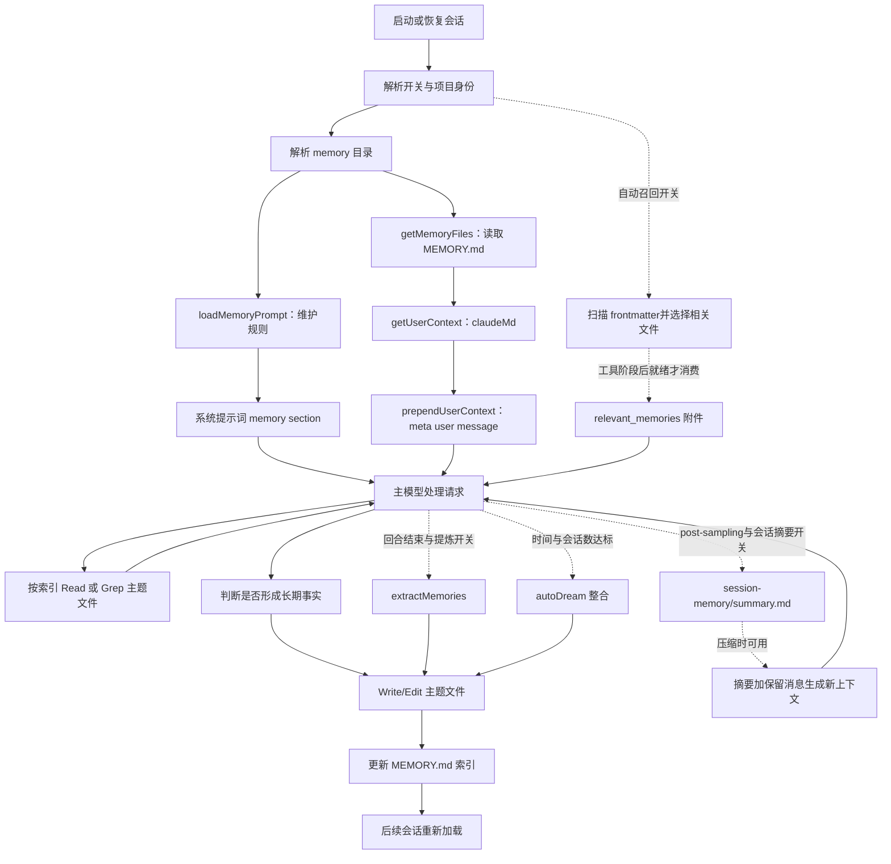

# Memory 完整链路与 Pi 插件剥离边界

核查日期：2026-10-26。分析对象：外部仓库 `claude-code-bun`，基线 `main@03cff1b749016690436a517977f4535782057b03`。

这是本仓库的**输入分析**，不是 `pi-cc-memory` 的实现说明。文中 `src/...` 路径均指 claude-code-bun 检出目录，不是本仓库。本仓库实际实现了什么，以 `docs/architecture.md` 和 `docs/milestones.md` 为准。

本次采用静态源码核查，没有启动 Claude Code、调用模型、读取 Claude 用户记忆目录的实际内容、安装依赖或运行测试。下文“默认”指源码的默认分支，不代表某个账号的 GrowthBook 缓存、环境变量和 settings 的现场值。Pi 接入点核对的是本机 `@earendil-works/pi-coding-agent@1.2.0` 的文档、声明和示例。

## 1. 先确定我们要剥离什么

本项目的 memory 没有单一总入口。核心是 **Markdown 文件 + 记忆维护提示词 + 按需读取 + 通用文件工具写入**；其上叠加自动召回、后台提炼、跨会话整合。另有用途不同的会话摘要和指令文件加载。

| 能力 | 持久化对象 | 核心 owner | 与 Pi memory 的关系 |
| --- | --- | --- | --- |
| Auto memory | 项目记忆索引及主题文件 | `src/memdir/` | 最适合作为第一批核心 |
| Instructions memory | `CLAUDE.md`、`CLAUDE.local.md`、`.claude/rules/` | `src/utils/claudemd.ts` | 属于指令发现系统；复用 Pi 自己的项目上下文加载更合理 |
| Relevant memory recall | 当前问题相关的主题正文 | `findRelevantMemories.ts` + `attachments.ts` | 可选召回层 |
| Extract memories | 从本轮新增对话提取长期事实 | `src/services/extractMemories/` | 可选后台写入层 |
| Auto dream | 整理既有记忆、吸收多个会话的信息 | `src/services/autoDream/` | 可选维护层，不是简单的退出摘要 |
| Session memory | 当前会话状态与工作摘要 | `src/services/SessionMemory/` | 服务 compaction，宜与长期记忆分开 |
| Agent memory | 特定 Agent 的持久记忆 | `src/tools/AgentTool/agentMemory.ts` | 扩展的身份及作用域维度 |
| Team memory | 组织成员共享的仓库记忆 | `src/services/teamMemorySync/` | 依赖 Anthropic 服务端，不能只复制客户端就获得完整能力 |

有两套同名类型，需要区分：

- `src/memdir/memoryTypes.ts`：记忆内容分类 `user / feedback / project / reference`。
- `src/utils/memory/types.ts`：文件来源分类，例如 `Managed / User / Project / Local / AutoMem / TeamMem`。

`type: user` 表示内容在描述用户，**不表示全局作用域**。默认 Auto memory 中四种类型都存入当前项目的 memory 目录。

## 2. 总链路

实线表示默认的主模型读写链；虚线表示需要独立开关或特定场景的链路。



关键理解：文件是持久事实来源；索引是导航；提示词让模型作记忆判断；宿主负责注入、执行、权限、取消和生命周期。源码里没有独立的向量数据库，也没有围绕 Auto memory 的统一 CRUD 服务。

## 3. 存储布局与项目身份

### 3.1 主会话 Auto memory

路径解析位于 `src/memdir/paths.ts`：

1. 有效的 `CLAUDE_COWORK_MEMORY_PATH_OVERRIDE`：直接指定完整 memory 目录。
2. 有效的 `autoMemoryDirectory`：按 `policySettings → flagSettings → localSettings → userSettings` 取值；故意排除仓库提交的 `projectSettings`。
3. 默认 `<memoryBase>/projects/<sanitize(canonicalGitRoot || projectRoot)>/memory/`。

`memoryBase` 优先取 `CLAUDE_CODE_REMOTE_MEMORY_DIR`，否则取 `getClaudeConfigHomeDir()`，后者支持 `CLAUDE_CONFIG_DIR`，默认 `~/.claude`。

```text
~/.claude/
├── projects/
│   └── <项目路径转换后的目录名>/
│       └── memory/
│           ├── MEMORY.md
│           ├── user_role.md
│           ├── feedback_testing.md
│           ├── project_release.md
│           ├── reference_dashboard.md
│           ├── .consolidate-lock          # autoDream 元数据
│           ├── logs/YYYY/MM/YYYY-MM-DD.md # KAIROS 分支
│           └── team/                     # TEAMMEM 分支
│               ├── MEMORY.md
│               └── *.md
└── agent-memory/<agentType>/              # Agent 的 user scope
```

`getAutoMemBase()` 使用 canonical Git root，因此同仓库的 worktree 默认共享 Auto memory。没有 Git 仓库则使用 projectRoot。目录名是路径转换结果，不是纯仓库 URL 或内容 hash；移动仓库路径会改变默认身份。

`sanitizePath()` 将非 ASCII 字母数字替换为 `-`；只有超长路径才附加 hash。因此不能把现有算法描述成“无碰撞的 project ID”。长路径的 hash 还会根据 Bun 是否存在选择实现。证据：`src/utils/git.ts`、`src/utils/sessionStoragePortable.ts`。

### 3.2 文件契约

主题文件的建议格式：

```markdown
---
name: 集成测试约定
description: 修改数据库行为时使用真实数据库验证的原因和适用条件
type: feedback
---

集成测试需要使用真实数据库。

**Why:** 用户曾遇到 mock 测试通过、生产迁移失败。
**How to apply:** 修改数据库行为及迁移时采用；不泛化到纯计算函数。
```

索引格式：

```markdown
# Memory

- [集成测试约定](feedback_testing.md) — 数据库行为及迁移验证的适用条件。
```

格式主要由 prompt 约束，不是写工具强制校验的数据库 schema。scanner 会解析 frontmatter 中的 `description` 和 `type`；缺少或不认识的 type 不会令整个文件不可用。

提示词明确要求：按主题组织、更新已有文件、避免重复、将相对日期转绝对日期、纠错时修改或删除旧事实；不把可由代码或 Git 重建的信息、已有 CLAUDE.md 内容、临时任务状态塞进长期记忆。这里应复用内容筛选原则，而非把源码中的工具名和宿主名字原样保留。

## 4. 默认读取与注入：规则和数据走两条路

### 4.1 规则进入系统提示词

```text
constants/prompts.ts:getSystemPrompt()
  → systemPromptSection('memory', () => loadMemoryPrompt())
  → memdir.ts:loadMemoryPrompt()
  → isAutoMemoryEnabled() / getAutoMemPath()
  → ensureMemoryDirExists()
  → buildMemoryLines()
  → 四类记忆、保存步骤、召回与过期规则
```

证据：`src/constants/prompts.ts`、`src/memdir/memdir.ts`。

普通主会话的 `loadMemoryPrompt()` **不把 MEMORY.md 正文放入系统提示词**。它只生成维护规则。`systemPromptSection` 缓存计算结果，通常在 `/clear` 或 `/compact` 后失效：`src/constants/systemPromptSections.ts`。

SDK 自定义 system prompt 有例外：`QueryEngine` 只有在自定义 prompt 且有效 `CLAUDE_COWORK_MEMORY_PATH_OVERRIDE` 存在时，显式补入 memory mechanics prompt：`src/QueryEngine.ts`。不能假定任何自定义 prompt 都自动保留记忆规则。

### 4.2 索引进入 user context

```text
context.ts:getUserContext() [memoize]
  → claudemd.ts:getMemoryFiles() [memoize]
  → 发现指令文件 + 单独读取 AutoMem MEMORY.md
  → parseMemoryFileContent()：frontmatter / 注释处理及索引截断
  → filterInjectedMemoryFiles()
  → getClaudeMds()
  → { claudeMd, currentDate }
  → query.ts:prependUserContext(messagesForQuery, userContext)
  → isMeta user message，包裹 <system-reminder>
  → API 请求
```

证据：`src/context.ts`、`src/utils/claudemd.ts`、`src/utils/api.ts`、`src/query.ts`。

默认只自动读索引；索引中的普通 Markdown 链接不会递归展开主题正文。模型根据索引提示自行 Read/Grep。AutoMem 的读取也没有使用指令文件的 `@include` 递归入口。

索引限额在 `src/memdir/memdir.ts`：

- 先 `trim()`，再限制 200 行。
- 再限制名为 `MAX_ENTRYPOINT_BYTES = 25_000` 的长度，尽量在换行处分割，附截断警告。
- 实际使用 `string.length / slice`，计量是 UTF-16 code units，**并非真实 UTF-8 bytes，也不是 token 上限**。

`CLAUDE_CODE_DISABLE_CLAUDE_MDS` 会阻止这条整个 user-context 发现链，因此即使 Auto memory 开关开启，也可能没有自动索引注入。`--bare` 和额外目录还有独立条件，移植时应避免将这些宿主组合开关隐式照搬。

### 4.3 与 CLAUDE.md 加载的交界

`getMemoryFiles()` 的发现顺序是 Managed → User → 从祖先目录到 CWD 的 Project/Local → 显式附加目录 → AutoMem → 可选 TeamMem。嵌套 worktree 会避开主仓库中重复的已提交指令，但仍允许读取 local 指令。

指令加载还包含：

- `.claude/rules/*.md`、frontmatter `paths` 条件规则；
- `@include`、循环路径去重和深度限制；
- 外部 include 信任与排除规则；
- 文件读取后通过 `nestedMemoryAttachmentTriggers` 延迟发现嵌套目录指令；
- `InstructionsLoaded` 事件；AutoMem/TeamMem 明确不算这个事件的 instructions。

这些属于宿主 instruction loader，不应为剥离长期记忆而一并搬入插件。证据：`src/utils/claudemd.ts`、`src/utils/attachments.ts`。

### 4.4 缓存刷新不是文件写后立即全量重读

同时存在 `getMemoryFiles`、外层 `getUserContext` 和系统 prompt section 缓存。普通 Write/Edit 会更新 `readFileState`，不会在这些工具里清空全部 prompt 缓存。

`runPostCompactCleanup()` 对主线程清理外层 user context 和内层 memory files；子 Agent 压缩不应清掉主线程这两层状态。`/clear`、恢复、worktree 切换、同步、打开 `/memory` 也有相应失效入口，但不能把“清了文件列表缓存”直接等价为“当前模型上下文已经刷新”。证据：`src/services/compact/postCompactCleanup.ts`、`src/commands/clear/caches.ts`。

## 5. 可选自动召回：scan → select → prefetch → attach

### 5.1 触发与准备

`src/utils/attachments.ts` 的 `startRelevantMemoryPrefetch()` 要求：

- Auto memory 开启；
- `tengu_moth_copse` 为 true，默认 false；
- 找到最后一条非 meta user message；
- 输入非空且包含空白字符；
- 当前消息中的已召回正文累计长度小于 `60 * 1024`。

开启该 gate 后，`filterInjectedMemoryFiles()` 会移除 AutoMem/TeamMem 索引，`buildMemoryLines(..., skipIndex=true)` 也不再要求维护索引。它是另一种检索模式，不只是默认索引模式上额外加一个搜索工具。

如果输入 `@agent-...` 且该 Agent 配置了 memory，则查询其 memory 目录；否则查询主项目 Auto memory 目录。

### 5.2 扫描与模型选择

`src/memdir/memoryScan.ts`：

1. 递归列出 `.md`，排除 basename 为 `MEMORY.md` 的文件。
2. 并发读取各文件前 30 行和 mtime，解析 description/type。
3. 按 mtime 从新到旧排序，最后截取 200 个候选。
4. 生成 `[type] relative/path.md (timestamp): description` manifest。

200 是候选输出限额；列目录和读取 header 发生在截取前，**不是 I/O 的硬限额**。

`src/memdir/findRelevantMemories.ts` 调用 `sideQuery()`，使用默认 Sonnet、JSON schema 输出和 256 输出 token。它传入用户问题、manifest、最近成功使用的工具名称，提示选择最多 5 条，并过滤不属于候选集合的文件名。模型自身的“最多 5 条”不是 schema 的 `maxItems`；最终附件组装还有 `.slice(0, 5)`。

没有 embedding、向量索引、BM25 或持久检索库。这里是**元数据扫描加模型重排**。

### 5.3 附件进入下一次模型调用

- 查询循环启动时发起 prefetch，与主模型生成和工具执行并行。
- 工具执行后的收集点：只有 promise 已就绪才消费；未就绪不等待，后续循环再尝试。
- 每条最多 200 行、4096 bytes，超限保留前段并附完整文件路径。
- 按历史附件和 `readFileState` 去重；消费后才写 `readFileState`，避免预取结果被自己过滤掉。
- 转换为 `relevant_memories` 附件，最终进入 meta user/system-reminder 消息。
- 退出 query loop 时 dispose 会取消未完成的预取。

证据：`src/query.ts`、`src/query.ts`、`src/utils/attachments.ts`、`src/utils/messages.ts`。

**因此自动召回不保证影响当前问题的第一条回答。** 如果模型直接输出最终答案、没有进入工具后收集点，附件可能根本没有被消费。索引又被 gate 移除时，尤其需要明确这种产品行为。

### 5.4 新鲜度

`memoryAge.ts` 用文件 mtime 计算天数；超过一天加入“这是某时点观察、需要验证”的提醒。附件创建时保存 header，避免后续每轮重新计算年龄而改变历史消息字节。普通 FileReadTool 读取 Auto memory 也会加入新鲜度提醒。

mtime 是文件更新时间，不能证明内容在该时间被重新核验。Pi 插件若增加 `verifiedAt`，应将其视为新契约。

## 6. 默认写入：模型判断 + 通用文件工具

### 6.1 谁决定记什么

默认由主模型依据 `memoryTypes.ts` 和 `buildMemoryLines()` 判断。用户要求“记住”时立即保存；反馈、项目背景和外部资源等由模型识别。没有一个确定性函数能保证每个回合都保存，也没有原生 `memory_write` 专用工具。

写入步骤是先主题文件、后索引；去重、合并、分类、过期纠正主要依赖 prompt。它不是跨两文件的事务。

### 6.2 如何落盘

```text
模型 Write/Edit
  → 工具参数与路径规范化
  → validateInput：权限 deny、已有文件读取状态、mtime、编辑内容等
  → checkWritePermissionForTool()
  → call()：再次核对读后是否修改
  → writeTextContent()
  → 更新 readFileState
  → 工具结果 / 文件历史 / UI / 统计
```

证据：`src/tools/FileWriteTool/FileWriteTool.ts`、`src/tools/FileEditTool/FileEditTool.ts`。通用工具有写前读取及陈旧内容保护；这不能替代 memory 级的类型校验、索引一致性、跨进程并发控制或恢复记录。

### 6.3 权限边界

`src/utils/permissions/filesystem.ts` 先检查 deny（含解析后的路径），再检查内部可编辑目录。默认 Auto memory 和 Agent memory 有专门写放行；读取也有内部路径放行。

完整路径的 Cowork override 不享有默认 Auto memory 的写放行，需要走调用方的正常权限配置。可信 settings 的 `autoMemoryDirectory` 可以获得该放行，所以源码排除了仓库提交的 projectSettings。

`isAutoMemPath()` 自身只是 normalize 后的目录前缀判断；不能单独拿来当 Pi 插件的 realpath/symlink 安全边界。读取和扫描也需要单独明确符号链接策略。

### 6.4 删除与遗忘

主模型的“忘掉”是删除/修改主题中的事实并维护索引；这条链路没有统一的 tombstone、版本记录、恢复 ID 或自动回滚 API。通用文件历史功能不等价于 memory 的完整遗忘与恢复契约。

后台提炼允许 Edit/Write，但拒绝写 shell 和 `rm`，因此“删除整份文件”也不应被当成后台 agent 现成的工具能力。它可以改内容、移除索引项；要实现可靠 forget，插件应显式定义行为。

## 7. 后台长期记忆提炼：extractMemories

入口与状态：

```text
startBackgroundHousekeeping()
  → feature('EXTRACT_MEMORIES')
  → initExtractMemories()

query loop 最终无工具响应
  → handleStopHooks()
  → 非 bare、主 Agent、EXTRACT_MEMORIES、isExtractModeActive()
  → executeExtractMemories()
  → 当前游标之后的新增消息数
  → 若已出现主模型 memory Write/Edit，则跳过并推进游标
  → 按 eligible turns 节流
  → scanMemoryFiles() 预装已有记忆清单
  → buildExtractAutoOnlyPrompt() 或 combined prompt
  → runForkedAgent(maxTurns=5, skipTranscript=true)
  → Write/Edit 主题和索引
  → 推进游标、生成 memory_saved 通知
```

关键出处：`src/utils/backgroundHousekeeping.ts`、`src/query/stopHooks.ts`、`src/services/extractMemories/extractMemories.ts`。

运行门槛包括 `tengu_passport_quail`，非交互另受 `tengu_slate_thimble` 控制；两者默认 false。提炼频率 `tengu_bramble_lintel` 默认每个合格回合一次。remote mode 不运行。

状态在初始化闭包内：cursor、inProgress、pendingContext、in-flight promises。运行中到达的新上下文只保留最新一份，当前完成后追加一次 trailing extraction。失败不推进成功游标，下轮可重试。print 模式会在输出后 drain，默认软等待上限 60 秒。

`createAutoMemCanUseTool()` 允许 Read/Grep/Glob、只读 Bash，以及 Auto memory 目录内 Write/Edit；REPL 是工具调用容器，内部调用仍走权限判断。并非 OS 级沙箱，也不是只允许读 memory 目录。

`runForkedAgent()` 复用父会话的 system/tools/model/messages 前缀，复制文件缓存和可变状态，生成独立 agentId，并累计 usage。它依赖完整 Claude query/ToolUseContext，不能作为独立 memory 核心直接移植：`src/utils/forkedAgent.ts`、`src/utils/forkedAgent.ts`。

两个需要修订的契约：

- `hasMemoryWritesSince()` 看 assistant 的 tool_use，并不核对对应 tool_result 成功；尝试写入失败也可能使本轮后台提炼跳过。
- `extractWrittenPaths()` 同样从 tool_use 统计，`memory_saved` 不是严格的落盘成功证明。

## 8. 跨会话整合：autoDream

这条服务在 `startBackgroundHousekeeping()` 中独立初始化，并由主 Agent 的 stop hook 调用。它**没有被 EXTRACT_MEMORIES 构建开关整体包住**。

开关优先取 `autoDreamEnabled`；没有设置时取 `tengu_onyx_plover.enabled`。还要求 Auto memory 开启，非 remote、非 KAIROS。默认阈值：24 小时、5 个近期被触及的其他会话；扫描节流 10 分钟。

```text
回合结束
  → 读 .consolidate-lock 的 mtime
  → 满足时间门槛
  → 扫描本 cwd 对应的会话 transcript
  → 满足会话数，排除当前会话
  → 获取带 PID 的整合锁
  → runForkedAgent(buildConsolidationPrompt(...))
  → orient / gather / consolidate / prune-and-index
  → 完成 DreamTask 与 Improved 通知
  → 失败则回退锁时间
```

证据：`src/services/autoDream/autoDream.ts`、`src/services/autoDream/consolidationLock.ts`、`src/services/autoDream/consolidationPrompt.ts`。

它是“回合结束检查时间和会话数”的触发器，不是 cron，也不保证每天夜间发生。KAIROS prompt 中提及的 nightly `/dream` 是另外的分支，不能据此断言当前构建具备 nightly job。

整合锁使用写 PID 后读回确认，mtime 同时充当上次整合时间。这个实现没有独占创建/CAS 保证，不能直接视为跨进程严格互斥。它也没有串行化所有主模型写入、提炼写入和整合写入。

## 9. 会话摘要与压缩：SessionMemory

### 9.1 存储和生成

路径与 Auto memory 分开：

```text
<projectDir>/<sessionId>/session-memory/summary.md
```

`projectDir` 来自当前 CWD 的 session storage；不是直接复用 canonical Auto memory 目录。模板和提示词支持 `~/.claude/session-memory/config/template.md`、`prompt.md` 覆盖。

`src/setup.ts` 调用 `initSessionMemory()` 注册 post-sampling hook；`src/query.ts` 在采样后触发。提炼还要求 `querySource === 'repl_main_thread'`、`tengu_session_memory` 开启以及 auto-compact 允许。

默认触发条件：先达到 10,000 上下文 token；此后较上次提炼增长至少 5,000 token，并且累计工具调用达到 3 次，或最后 assistant turn 无工具调用。它不是每轮都执行。

创建目录和模板文件后，先 Read 当前摘要，再 fork agent；权限只允许 Edit **这一份确切 summary.md**。模板包含 Current State、Task specification、Files and Functions、Errors & Corrections、Key results、Worklog 等，明显适合会话续接而非跨项目长期偏好。

### 9.2 摘要如何替代压缩调用

`autoCompact()` 和无额外指令的手动 `/compact` 会尝试 `trySessionMemoryCompaction()`：

1. 检查 `ENABLE_CLAUDE_CODE_SM_COMPACT` / `DISABLE_CLAUDE_CODE_SM_COMPACT` 或两项动态 gate。
2. 有提炼在运行则等待，最多约 15 秒；超过 60 秒视为 stale，不继续等待。
3. 读取 summary；不存在、只有空模板、游标找不到等则返回 null，回退普通压缩。
4. 从已总结消息边界向后保留内容，并向前补足默认 10k token、5 条有文字消息，目标上限 40k。
5. 修正边界以保留 tool_use/tool_result 和相同 assistant message ID 的 thinking 块；因此 40k 不应解读为所有情况下的绝对硬上限。
6. 生成 compact boundary、summary message、必要附件和保留消息；总量仍过阈值则回退。

出处：`src/services/SessionMemory/sessionMemory.ts`、`src/services/SessionMemory/sessionMemoryUtils.ts`、`src/services/compact/sessionMemoryCompact.ts`。

12,000 token 总摘要预算主要由更新 prompt 提醒；注入时另做每 section 约 2,000 token 对应字符数的截断，不能把两者混成一个强制总限额。

这部分在 Pi 中应优先对接现成 compaction。没有必要为了长期记忆 MVP 替换 Pi 的整套消息裁剪逻辑。

## 10. Agent、团队和管理入口

### 10.1 Agent memory

Agent 配置的 `memory: user | project | local` 由 `loadAgentsDir.ts` 解析。开启后，在自定义 Agent prompt 后附 `loadAgentMemoryPrompt()`；该函数使用 `buildMemoryPrompt()`，**会将该 Agent 的 MEMORY.md 内容直接合入 prompt**。这与主会话的 user-context 索引路径不同。

| scope | 默认路径 | 实际边界 |
| --- | --- | --- |
| user | `<memoryBase>/agent-memory/<agentType>/` | 同 Agent 跨项目 |
| project | `<cwd>/.claude/agent-memory/<agentType>/` | 当前工作目录、可随版本控制共享 |
| local | `<cwd>/.claude/agent-memory-local/<agentType>/` | 当前机器和目录；remote memory mount 下改用项目命名空间 |

Project/local 的普通路径基于 CWD，并非与 Auto memory 完全一致的 canonical root 规则。Agent 名只替换冒号，移植时应使用独立、明确的身份和路径验证契约。

已定义工具列表的 Agent 会自动补入 Read/Write/Edit。快照在 `.claude/agent-memory-snapshots/<agentType>/`，另受 `AGENT_MEMORY_SNAPSHOT` 构建开关控制；初始化仅处理 user scope。无本地记忆时复制快照；发现更新则记录 `pendingSnapshotUpdate`。`main.tsx` 为 `--agent` 模式预留了更新对话框，但当前 `SnapshotUpdateDialog.ts` 返回 null，`buildMergePrompt()` 返回空字符串；replace/mark-synced 函数也未发现外部调用。因此当前没有可直接移植的完整快照更新交互。证据：`src/tools/AgentTool/agentMemory.ts`、`src/tools/AgentTool/loadAgentsDir.ts`、`src/tools/AgentTool/agentMemorySnapshot.ts`、`src/components/agents/SnapshotUpdateDialog.ts`。

### 10.2 Team memory

本地目录是 Auto memory 下的 `team/`。构建开关 `TEAMMEM`、Auto memory 开关和 `tengu_herring_clock` 共同限制功能；远端同步还需要符合条件的 OAuth 和 GitHub 仓库身份。

```text
setup → startTeamMemoryWatcher
  → initial pull
  → 校验 key/路径、写本地文件、清 getMemoryFiles 缓存
  → fs.watch recursive
  → 写入后 debounce 2 秒
  → 计算内容 hash delta
  → PUT /api/claude_code/team_memory?repo=owner/repo
  → ETag 冲突时拉 hashes、重算 delta 并有限重试
  → shutdown 时 best-effort flush
```

独立的 PostToolUse 访问 hook 也会通知 watcher，补偿文件事件遗漏。写工具有 secrets guard；同步过程中也会扫描秘密、验证路径。部分不可自行恢复的失败会抑制后续重试，避免事件风暴。

同步语义必须单独保留记录：pull 对同 key 以 server 为准；本地编辑触发的 push 采用 delta upsert；没有内容级 merge；**本地删除不传播，后续 pull 可恢复远端文件**。证据：`src/services/teamMemorySync/index.ts`、`src/services/teamMemorySync/watcher.ts`、`src/memdir/teamMemPaths.ts`。

### 10.3 管理入口

- `/memory`：真实注册的 local JSX 命令。展示指令文件、打开 Auto/Team/Agent memory 文件夹、修改 autoMemory/autoDream 用户设置、调用外部编辑器；不是 CRUD API。`src/commands/memory/memory.tsx`、`src/components/memory/MemoryFileSelector.tsx`。
- `/remember`：bundled skill，但注册函数要求 `USER_TYPE === 'ant'`。用途是审阅并提出记忆迁移/清理建议，不直接应用。其保留临时内容的措辞与当前长期记忆提示词不完全一致，移植应统一策略。`src/skills/bundled/remember.ts`。
- `/summary`：`commands.ts` 有 import/注册引用，但目标 `src/commands/summary/index.js` 仅导出 `{ isEnabled: () => false, isHidden: true, name: 'stub' }`，没有连到 `manuallyExtractSessionMemory()`；只能确认存在手工提炼函数。
- `/dream`：`src/skills/bundled/index.ts` 留有 `KAIROS || KAIROS_DREAM` 下的 require/注册分支，但当前仓库缺少 `dream.js` 及对应 TS 源文件。可确认的运行服务是 autoDream，不能把注册残留当成命令已可用的证据。
- `MemoryUpdateNotification.tsx` 组件文件存在，但没有找到实际组件调用；后台的可见通知使用 `memory_saved` 系统消息渲染。避免提取孤立 UI 文件当作运行链入口。

## 11. 当前构建可达性

仓库 `CLAUDE.md` 的部分说明已落后于源码，例如把 GrowthBook 描述成空实现、说没有测试脚本。实际 `growthbook.ts` 包含读取 overrides、内存值与磁盘缓存的实现，`package.json` 也定义了 `bun test`。分析以当前代码为准。

| 能力 | 源码 gate | 未配置时的判断 |
| --- | --- | --- |
| 主模型 Auto memory | env → SIMPLE/remote 条件 → `autoMemoryEnabled` | 一般默认开 |
| 主会话索引 | 上述开关 + getUserContext 条件 + `!tengu_moth_copse` | 一般默认加载 |
| 相关正文预取 | `tengu_moth_copse` | 默认关 |
| 回合末提炼 | 构建 `EXTRACT_MEMORIES` + `tengu_passport_quail`，非交互再看 `tengu_slate_thimble` | 当前未启用构建 feature 的路径不能假定运行 |
| Auto dream | `autoDreamEnabled` 或 `tengu_onyx_plover.enabled` | 无配置和远端默认时关；可单独开启 |
| Session memory 提炼 | `tengu_session_memory` + auto-compact 等 | 默认关 |
| Session memory 压缩 | env override 或 `tengu_session_memory && tengu_sm_compact` | 默认关 |
| Team memory | 构建 `TEAMMEM` + `tengu_herring_clock` | 当前默认构建不可达 |
| 每日日志 prompt | 构建 `KAIROS` + active 状态 | 当前默认构建不可达 |
| Agent memory | Auto memory 开关 + agent.memory | 按 Agent 配置启用 |
| Agent memory 快照 | 构建 `AGENT_MEMORY_SNAPSHOT` | 当前默认构建不可达，更新 UI 仍是 stub |

`cli.tsx` 的局部 feature 返回 false，其他模块使用 `bun:bundle` 的构建 feature；当前 `build.ts` 未配置启用这些 feature。**不能进一步推导所有 GrowthBook 动态开关都恒为 false。** 实际运行值仍取决于对应 runtime 配置、事件日志资格及缓存，本次没有读取用户现场设置来确定。

## 12. 剥离为 Pi 插件：核心与适配层

### 12.1 可独立复用的部分

| 部分 | 可保留的行为 | 应移除/替换的依赖 |
| --- | --- | --- |
| 记忆策略 | 四类型、去重、按主题、过期验证、相对日期转换 | Claude 名称、硬编码 Write/Edit/Grep、内部实验措辞 |
| Markdown codec | frontmatter、manifest、索引格式 | 抽出必要解析，不导入完整 Claude utils |
| 目录解析 | 项目隔离、worktree 共享、可信 override | bootstrap 全局状态、Claude settings、Bun hash |
| 存储 | 读写、内容版本、新鲜度、索引维护 | ToolUseContext、React store、LSP、VSCode、分析上报 |
| Recall | header scan、候选选择、限制正文、去重 | Sonnet 固定模型、sideQuery、Claude attachments/message union |
| Extraction | 增量游标、失败重试、合并排队 | runForkedAgent、query.ts、CanUseToolFn |
| Consolidation | 时间/会话数门槛、整合提示词 | Claude transcript layout、DreamTask、弱锁 |
| UI/配置 | 查看、编辑、状态、开关 | Ink 组件、Claude commands/settings 系统 |

建议的依赖方向是 `Pi extension → lifecycle/service → memory core → storage`；模型调用通过接口注入。核心不 import Pi UI、Claude query 或 Anthropic SDK。

一个候选目录划分，仅表达边界，不是已确定的实现计划：

```text
pi-memory-plugin/
├── package.json
├── src/
│   ├── extension.ts        # Pi 注册与生命周期接线
│   ├── config.ts           # 插件设置及可信来源
│   ├── core/
│   │   ├── identity.ts     # project / agent / store identity
│   │   ├── format.ts       # 类型、frontmatter、manifest
│   │   ├── policy.ts       # 记忆维护规则
│   │   ├── store.ts        # read/upsert/forget + 索引一致性
│   │   └── recall.ts       # 候选、预算、结果校验
│   ├── services/
│   │   ├── extraction.ts   # 可选：成功回合后的增量提炼
│   │   └── consolidation.ts # 可选：跨会话维护
│   └── adapters/
│       ├── filesystem.ts
│       ├── pi-model.ts
│       └── pi-session.ts
└── resources/              # 策略模板等
```

### 12.2 已核对的 Pi 接入点

| Claude 行为 | Pi 1.2.0 对应契约 | 接入注意点 |
| --- | --- | --- |
| 初始化项目与会话状态 | `session_start` | reason 覆盖 startup/reload/new/resume/fork；重建当前实例状态 |
| 注入长期规则和稳定索引 | `before_agent_start` 的 `systemPromptOptions.sections` | 可用独立 `pi_memory` section；避免拼接替换整个 systemPrompt |
| 注入本次相关正文 | `before_agent_start` 返回 custom message；或 `context` 改本次消息 | 前者能随会话保存；后者是请求级转换，应明确预算和去重语义 |
| 等待回合真正收尾再提炼 | `agent_before_settle` | 可以检查 outcome；`agent_end` 之后可能仍有自动恢复、压缩、重试和排队续接 |
| 只观察最终完成 | `agent_settled` | 通知型事件，不应假设可修改上下文或要求继续 |
| 记录成功的显式 memory 写入 | 专用工具 execute 结果，或 `tool_result` | 按成功结果推进游标，避免继承 tool_use 误判 |
| 非上下文的提炼游标 | `pi.appendEntry()` + `sessionManager.getBranch()` | 只从当前分支恢复；不能扫整个文件混入已放弃分支 |
| 外部模型选择/提炼 | `ctx.modelRegistry.complete()` / `streamSimple()` | 模型可配置、传取消信号；这些调用本身不是完整工具型 Agent loop |
| 可选会话摘要 | `session_before_compact` | 复用 preparation.firstKeptEntryId；返回自定义 compaction 或回退内置 |
| 压缩与分支导航后刷新 | `session_compact` / `session_tree` | 重算已注入集与预算，保留长期存储 |
| 退出、reload、切会话 | `session_shutdown` | 幂等取消/flush；不能只覆盖正常退出 |
| 用户操作入口 | `registerCommand()` / `registerTool()` / `ctx.ui` | 兼容无 UI 的 print/JSON 及 RPC 模式 |
| 发布安装 | Pi package manifest | `pi.extensions` 指向入口，宿主包作为 peerDependencies |

核查参考：本机 Pi 的 `docs/extensions.md`、`docs/compaction.md`、`docs/packages.md`、`dist/core/extensions/types.d.ts`、`dist/core/system-prompt.d.ts` 和 `examples/extensions/custom-compaction.ts`。这些是当前安装版本的契约，不是跨所有 Pi fork/旧版本的兼容保证。

Pi 扩展的文件变更可以使用宿主提供的 `withFileMutationQueue()` 包住完整读改写；跨进程写入仍需要插件自己的锁或版本比较。专用 memory 工具能统一成功判定、路径约束、索引维护和恢复，比把 Claude 通用文件工具整套搬过来更容易形成稳定契约。

### 12.3 建议的第一版范围

先闭合“下一次会话能正确用上本次记忆”这一条：

1. 项目身份与持久 Markdown store；保留同仓库 worktree 共享。
2. 类型化主题文件 + 简短索引；稳定注入规则和索引。
3. 按需读/查，以及显式保存、更新、遗忘；成功后原子维护索引。
4. 会话切换/恢复/分支/压缩时不丢索引、不串项目、不重复灌入正文。
5. 可见的 `/memory` 状态与管理入口，非交互模式也可用。

然后再增加自动提炼和正文召回，最后考虑跨会话整合、Agent scope 和团队同步。Session memory 可继续交给 Pi 内置 compaction，单独决定是否需要持久 summary。

项目路径之外是否额外提供全局用户 store、是否替换现有 pi-memory、是否导入旧记忆、后台模型和调用预算，都是尚未在本次分析中确定的产品选择。不要因读到了旧记忆文件而自动进行迁移。

## 13. 不应照搬的细节与后续核验重点

| 已观察到的实现 | 后续需要明确或修订的行为 |
| --- | --- |
| 索引“bytes”实际是 JS string.length | 分开真实 bytes、行数和 token budget；中文要有明确口径 |
| 无空白输入不触发召回 | 中文完整句子可能无空格；用语言无关的输入有效性判断 |
| 自动召回关闭索引且只在工具阶段后消费 | 明确首答前是否必须有记忆；没有工具调用时也要有可解释行为 |
| 60KiB 只在预取开始前检查，累计使用 content.length | 是软门槛，可能被最后一批越过；需要总量硬限制时应裁剩余预算 |
| scan 先读所有文件，再取最新 200 个 | 控制扫描并发和总读取量；旧但重要的记忆不应只因 mtime 被排除 |
| 写入统计取 tool_use | 用成功结果和内容版本作为提交依据 |
| 主题文件与索引分两次工具写 | 中断、失败、并发时需要修复孤儿文件/坏链接或事务策略 |
| isAutoMemPath 是路径字符串前缀判断 | 处理目录边界、符号链接、可信覆盖设置和允许的文件类型 |
| project key 用字符替换 | 定义稳定且抗碰撞的身份；导入旧布局时保留映射 |
| Auto memory 与 Agent memory 使用不同根规则 | 明确 scope 与身份是两个维度，避免 CWD 漂移 |
| SessionMemory 有模块级游标、状态 | 每实例/会话隔离；自动提炼路径异常时也必须在 finally 清理状态 |
| Dream 锁不是独占获取，且未与其他写者协调 | 建立 store 级串行提交与跨进程冲突策略 |
| Team 同步不传播删除 | 如果插件支持 forget，远端也要有可核验的删除/墓碑契约 |
| 备注、实验注释引用测试和命令 | 在本仓库找实际入口和文件，不把上游历史注释当成可运行证据 |

本次在 memory 核心目录、相关服务与 AgentTool 下未发现随仓库提供的 `*.test.*` / `*.spec.*` 文件。源码的“tested/eval-validated”注释不能代替当前基线的执行证据。后续实现应优先核验：跨项目/worktree 隔离、保存后下一会话召回、失败写入不冒充成功、并发不丢内容、中文预算、遗忘不复活、恢复/分支/压缩/取消生命周期。

仓库还包含 `src/**/src/**` 下的自动生成 type stubs。例如 `src/utils/src/context.ts` 只有类型占位，`src/utils/permissions/src/tools/AgentTool/agentMemory.ts` 也不是运行实现。剥离时应沿真实 import 解析定位 owner，避免按同名文件批量复制。

## 14. 后续阅读顺序

| 目的 | 入口 |
| --- | --- |
| 理解最小长期记忆闭环 | `src/memdir/paths.ts` → `src/memdir/memoryTypes.ts` → `src/memdir/memdir.ts` |
| 找到数据注入位置 | `src/context.ts` → `src/utils/claudemd.ts` → `src/utils/api.ts` |
| 提取召回功能 | `src/memdir/memoryScan.ts` → `src/memdir/findRelevantMemories.ts` → `src/utils/attachments.ts` → `src/query.ts` |
| 提取增量写入调度 | `src/query/stopHooks.ts` → `src/services/extractMemories/extractMemories.ts` → `src/services/extractMemories/prompts.ts` |
| 提取整合策略 | `src/services/autoDream/autoDream.ts` → `src/services/autoDream/consolidationPrompt.ts` → `src/services/autoDream/consolidationLock.ts` |
| 理解会话续接边界 | `src/services/SessionMemory/sessionMemory.ts` → `src/services/compact/sessionMemoryCompact.ts` |
| 理解宿主耦合 | `src/utils/forkedAgent.ts` → `src/utils/permissions/filesystem.ts` → `src/Tool.ts` |
| 找到 UI 和配置入口 | `src/components/memory/MemoryFileSelector.tsx` → `src/utils/settings/types.ts` |
